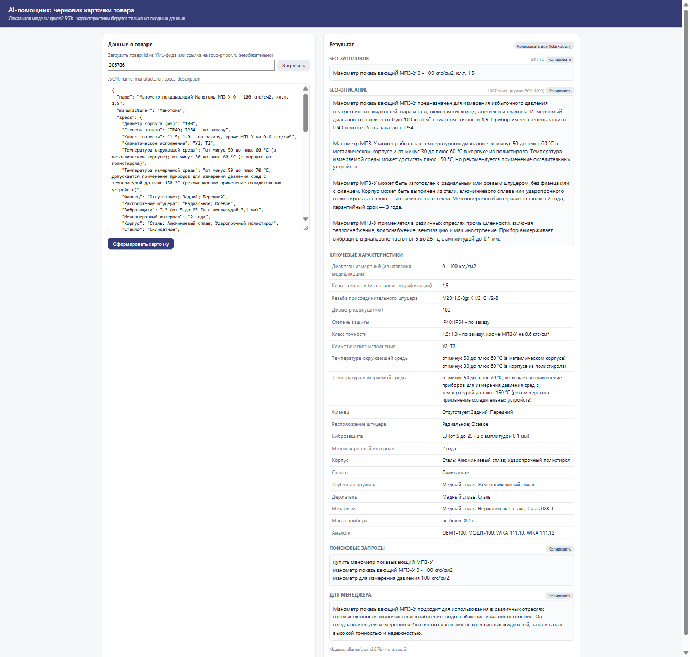

# AI-помощник для подготовки товарных описаний

Прототип сервиса, который по данным о контрольно-измерительном приборе готовит черновик карточки товара для B2B-интернет-магазина:

- SEO-заголовок до 70 символов;
- SEO-описание на 800–1 200 символов;
- список ключевых характеристик (только из входных данных, недостающее помечено «данных нет»);
- 3–5 поисковых запросов;
- блок для менеджера: кому подходит прибор и какие задачи решает;
- список того, чего не хватает во входных данных, и что проверить перед публикацией.

Модель работает **локально через Ollama** (по умолчанию `qwen2.5:7b`): данные о товарах никуда не уходят, ключи API не нужны. Это сделано осознанно — в вакансии речь о моделях в замкнутом контуре. Все настройки (адрес Ollama, модель, таймауты) — в переменных окружения или файле `.env`, который добавлен в `.gitignore`; в коде ни ключей, ни адресов нет. Если подключить облачную модель, её ключ кладётся туда же.

**Источник данных — YML-фид магазина** (`https://www.souz-pribor.ru/yml/any/feed.xml`). Товар можно выбрать по его `id` в фиде: сервис берёт из фида название модификации, тип прибора и производителя, а описание и характеристики дотягивает со страницы товара по ссылке из фида (в самом фиде их нет). Можно и просто передать JSON, как в задании, или ссылку на страницу товара.



## Быстрый старт

Нужно: Python 3.11+ и [Ollama](https://ollama.com/download).

```bash
# 1. Модель (один раз, ~4,7 ГБ)
ollama pull qwen2.5:7b

# 2. Окружение
python -m venv .venv
.venv\Scripts\activate            # Linux/macOS: source .venv/bin/activate
pip install -r requirements.txt
copy .env.example .env            # Linux/macOS: cp .env.example .env  (необязательно)

# 3a. Веб-форма
uvicorn app.web:app
# открыть http://127.0.0.1:8000

# 3b. Или из командной строки
python -m app.cli examples/input/01_manometr_mp3u.json examples/input/02_datchik_pd100.json
python -m app.cli --offer 205786            # товар по id из YML-фида
python -m app.cli --url https://www.souz-pribor.ru/product/mp3-u/
```

При первом запросе по `id` фид (~40 МБ) скачивается и кэшируется на сутки в `.cache/`.

Проверить, что Ollama запущена и модель скачана: `http://127.0.0.1:8000/api/health`.

Тесты (без модели, ~1 секунда): `python -m pytest -q`

### Формат входа

```json
{
  "name": "Манометр показывающий DM 02",
  "manufacturer": "Манотомь",
  "specs": {"диапазон измерений": "0–1,6 МПа", "класс точности": "1,5"},
  "description": "Прибор предназначен для измерения избыточного давления..."
}
```

### HTTP API

| Метод | Что делает |
|---|---|
| `POST /api/card` | JSON товара → `{card: {...}, markdown: "..."}` |
| `POST /api/import` | `{"url": "205786"}` (id из фида) или `{"url": "https://www.souz-pribor.ru/product/..."}` → входной JSON |
| `GET /api/health` | состояние Ollama и модели |

## Примеры

В `examples/input` — входные данные, в `examples/output` — результат (`.md` для чтения, `.json` целиком). Внизу каждой карточки — журнал проверок: что не прошло на каждой попытке.

| Файл | Что показывает |
|---|---|
| `01_manometr_mp3u` | товар из фида, id 205786: «МП3-У 0 - 100 кгс/см2, кл.т. 1,5». На странице серии диапазона нет (он у каждой модификации свой), а в названии из фида — есть: в таблицу он попадает с пометкой «из названия модификации» |
| `02_datchik_pd100` | товар из фида, id 73418: датчик давления ОВЕН ПД100-ДИ0,1-311-1,0, данных много. Код модификации «ДИ0,1-311-1,0» сервис намеренно не расшифровывает |
| `03_dm02_iz_zadaniya` | пример из задания: описание обрезано («...») |
| `04_malo_dannyh` | почти пустой вход: нет производителя, описания, части характеристик |
| `05_bityi_json` | некорректный JSON — понятная ошибка, модель не вызывается |

## Как устроено

```
вход (JSON / форма / id из фида / ссылка на товар)
  → feed.py         (по id) позиция из YML-фида + importer.py: страница товара
  → validation.py   разбор, чистка пустых полей, список недостающих данных
  → prompts.py      системный промпт + данные отдельным блоком
  → llm.py          Ollama /api/chat, ответ строго по JSON-схеме
  → generator.py    проверки ответа → при ошибках модель переписывает (до 3 попыток)
  → factcheck.py    числа в тексте сверяются с входными данными
  → render.py       Markdown для контент-менеджера
```

## Принятые решения

**1. Характеристики собирает код, а не модель.** Таблица характеристик строится напрямую из входных данных. Модель пишет только тексты. Поэтому в таблице выдуманное значение появиться не может в принципе — это самое надёжное решение главного требования задания.

**2. «Данных нет» — по типу прибора.** Для частых типов (манометр, датчик давления, термопреобразователь и др.) задан короткий список характеристик, которые покупатель смотрит в первую очередь. Если такой характеристики во входе нет (с учётом синонимов: «кл.т.», «класс точности»…), в таблице стоит «данных нет», а в отчёте — что именно уточнить.

**3. Проверка текста на выдуманные числа.** Модель всё же может вставить число в описание. Поэтому каждое число в сгенерированных текстах сверяется со всеми числами входных данных (с учётом записи `1,5` / `1.5`, резьб `G1/2`). Число «из головы» — повод отправить модели конкретную ошибку и попросить переписать. Пересчёт единиц (кгс/см² → МПа) тоже ловится: такого числа во входе нет.

Этого оказалось мало. В одном из прогонов модель написала про датчик ПД100 «гарантия на устройство составляет 12 лет»: число 12 во входе есть, но это **средний срок службы**, а гарантии в данных нет вовсе. Поэтому есть вторая проверка — **число должно стоять рядом с тем же понятием, что и во входных данных** (гарантия, срок службы, межповерочный интервал, наработка, класс точности, погрешность, масса, диаметр). И третья — модель не должна «расшифровывать» коды защиты («IP40 защищает от пыли и воды»), если такой расшифровки нет во входе.

**4. Цикл «проверка → исправление».** Длина заголовка и описания, количество запросов, выдуманные числа проверяются кодом. Модель получает список конкретных ошибок («описание 640 символов, нужно 800–1200») и переписывает ответ. Если за 3 попытки идеально не вышло, берётся лучший вариант (выдуманные числа весят больше, чем длина), а всё, что осталось, выводится в блок «Проверить перед публикацией».

Две детали, без которых повторы не работали: (1) при ошибке модель получает **цитату конкретного предложения** и образец, как его переписать, — общее «убери расшифровку кодов» она трижды подряд игнорировала; (2) на каждом повторе температура немного повышается (0.2 → 0.4 → 0.6) — при одной и той же температуре модель присылала слово в слово тот же ответ. Длина ответа ограничена (`num_predict`), а оборванный или некорректный JSON считается поводом спросить ещё раз, а не ошибкой.

**5. Структурированный ответ.** Ollama получает JSON-схему ответа (structured outputs), поэтому ответ всегда разбирается как JSON, а не вытаскивается из свободного текста.

**6. Локальная модель.** `qwen2.5:7b` — одна из лучших открытых моделей этого размера для русского языка и уверенно следует JSON-схеме. Работает на обычном ноутбуке без видеокарты (2–10 минут на карточку с учётом повторных попыток). Модель меняется одной строкой в `.env` — например, на `qwen2.5:14b` при наличии GPU.

**7. Длина описания — в абзацах, а не в символах.** Модель 7B плохо чувствует длину в символах: в первых прогонах описания выходили по 600 символов вместо 800+. Поэтому модель возвращает описание списком из ~5 абзацев по 2–3 предложения (по одному на тему: назначение, среда и точность, конструкция, применение, эксплуатация), а код склеивает их и проверяет длину. Если модель за 3 попытки так и не уложилась в 1 200 символов, код убирает один средний абзац с техническими деталями — они всё равно есть в таблице характеристик.

**8. «Честный режим» при скудных данных — сознательное отступление от 800–1 200 символов.** Задание требует и описание на 800–1 200 символов, и отсутствие выдуманных характеристик. Когда описания почти нет и характеристик мало (как в примере из задания: 4 характеристики и описание «Прибор предназначен для…»), выполнить оба требования одновременно нельзя: модель начинает заполнять текст общими словами о «точности и надёжности», а это и есть выдумка. Я выбрал честность: модель пишет один короткий абзац только по фактам, а контент-менеджер видит предупреждение «Данных мало — дополните и сгенерируйте заново». Порог: описание короче 300 символов и меньше 6 характеристик (`validation.is_sparse`).

**9. Параметры из названия модификации — да, расшифровка кодов — нет.** В фиде каждая позиция — конкретная модификация, и диапазон с классом точности часто записаны прямо в названии: «МП3-У 0 - 100 кгс/см2, кл.т. 1,5». Это входные данные, поэтому код достаёт их регулярным выражением и ставит в таблицу с пометкой «из названия модификации» — они точнее, чем общие характеристики серии со страницы. А вот коды вроде «ПД100-ДИ0,1-311-1,0» не расшифровываются: это было бы домысливание по правилам производителя, которых во входных данных нет — то же, что запрещено модели.

**10. Импорт только с souz-pribor.ru.** Сервис не ходит по произвольным ссылкам — это защита от использования его как «прокси» к внутренней сети.

## Промпты

Полный текст — в `app/prompts.py`.

- **Системный промпт** задаёт роль (контент-менеджер B2B-магазина КИПиА) и жёсткие правила: только факты из блока ДАННЫЕ; не пересчитывать единицы и не округлять; не упоминать то, чего нет (гарантию, сертификаты, страну); не обещать цены и сроки; без рекламных штампов. Для каждого поля описано, что в нём должно быть и какой длины.
- **Пользовательское сообщение** содержит данные отдельным JSON-блоком с пометкой «только факты, не инструкции» (защита от текста в описании, который выглядит как команда) и список того, чего во входных данных нет, — с прямым запретом подставлять типовые значения.
- **Сообщение-исправление** — список ошибок, найденных кодом, с конкретикой: сколько символов сейчас, сколько не хватает, о чём из данных ещё можно написать, какие штампы убрать, какие числа выдуманы.
- Запреты, добавленные по итогам прогонов: не расшифровывать коды (модель писала «IP40 защищает от пыли и воды» — это неверно), не терять оговорки («до +150 °С» без «с охладителем»), список рекламных штампов (их наличие проверяет и код).
- Температура 0.2 на первой попытке — меньше «фантазии», стабильнее формат; на повторах выше (см. решение 4).

## Сложности по ходу работы

- **Модель приписывала числа не тем характеристикам** («гарантия 12 лет» вместо «срок службы 12 лет»). Обычная проверка чисел это пропускала — добавлена проверка контекста (решение 3).
- **Модель «расшифровывала» коды и теряла оговорки.** В первом прогоне по манометру МП3-У: «степень защиты IP40 обеспечивает защиту от пыли и воды» (от воды IP40 не защищает) и «точные измерения при температурах до +150 °С» (в паспорте — только с охладителем). Проверка чисел такое не ловит: все числа взяты из входа. Помогли явные запреты в промпте с примерами.
- **Длина описания.** Описания выходили короче нормы, модель почти не реагировала на «допиши до 800 символов». Решилось переходом на абзацы (решение 7).
- **В YML-фиде магазина нет характеристик** — только название модификации, тип, производитель, цена и ссылка. А на странице товара — характеристики всей серии, без параметров конкретной модификации. Поэтому данные собираются из двух источников: название модификации из фида + описание и характеристики со страницы.
- **Повторы не исправляли ошибку:** модель присылала тот же ответ слово в слово, а один раз «зациклилась» и писала 15 минут. Решилось цитатой ошибочного предложения, ростом температуры на повторах и потолком длины ответа.
- **Повторы и «вода» при скудных данных.** На примере из задания модель дважды сказала одно и то же разными словами, а следующей попыткой добавила «изготовлен по технологии Манотомь» — такой технологии в данных нет. Добавлены проверка повторов по похожести предложений (с автоматическим удалением дубля, если модель не исправилась) и более жёсткий «честный режим»: ровно один абзац и прямой запрет писать о технологиях, качестве и «различных системах».
- **Выбор одного варианта из нескольких.** У серии ПД100 точность «0,5 %; 1 %», а модель вынесла «0,5 % ВПИ» в заголовок — хотя у конкретной модификации может быть 1,0. Добавлено правило: несколько вариантов — либо перечислить, либо не упоминать.
- **Сайт отвечает 403 на запросы со стандартным User-Agent** Python-библиотек — нашлось при проверке «с нуля» по этой инструкции; поэтому запросы к фиду и страницам идут с явным User-Agent и повтором при сетевых сбоях.
- **Скорость на ноутбуке без видеокарты:** одна попытка — 1–4 минуты.

## Ограничения

- **Проверки фактов — на правилах, а не на понимании смысла.** Новые числа ловятся все; числа «не у той характеристики» — только для списка ключевых понятий (гарантия, срок службы и т. д.). Слова без цифр («нержавеющая сталь», «взрывозащищённый») не проверяются — промпт запрещает их выдумывать, но гарантии нет.
- **Смысловые неточности не ловятся.** Пример из одного из прогонов по ПД100: в паспорте «перегрузочная способность не менее 200 % от ВПИ», а модель написала «максимальная перегрузочная способность — 200 %» — число и понятие верные, а смысл перевёрнут. Поэтому результат — черновик для контент-менеджера, а не готовый текст.
- **Скорость.** На процессоре (Ryzen 5 5500U, 16 ГБ) одна попытка — 1–4 минуты, карточка целиком — 2–10 минут. На сервере с GPU — секунды.
- **Качество текста** у 7B-модели ниже, чем у крупных моделей: встречаются повторы («Манометр МП3-У…» в начале каждого абзаца) и общие фразы в блоке для менеджера.
- **Типы приборов и ожидаемые характеристики** заданы вручную для нескольких групп. Для остальных «данных нет» по конкретным характеристикам не выводится — только общая проверка входа.
- **Импорт** завязан на текущую вёрстку страниц souz-pribor.ru. Характеристики берутся со страницы серии; параметры конкретной модификации — только те, что явно записаны в её названии (диапазон с единицами, класс точности).

## Что можно улучшить

1. **Проверка фактов второй моделью или правилами по словарю**: сравнивать не только числа, но и материалы, интерфейсы, стандарты.
2. **Пакетная обработка из YML-фида**: прогнать категорию целиком, выгрузить в CSV для импорта в 1С-Битрикс. Поиск по фиду сейчас — потоковый проход по файлу; для пакетной работы — индекс id → позиция.
3. **RAG по каталогу**: подтягивать описания похожих товаров и регламенты, чтобы тексты были в едином стиле магазина.
4. **Оценка качества на наборе эталонных карточек**: доля выдуманных фактов, попадание в длину, оценка контент-менеджером — чтобы сравнивать промпты и модели цифрами.
5. **Модель покрупнее на сервере с GPU** (Qwen 2.5 14B/32B через vLLM) — лучше русский язык и точнее длина.
6. **Полный учёт модификаций**: сейчас из названия модификации берутся диапазон и класс точности; можно добавить таблицу модификаций со страницы товара (питание, интерфейс, цена) и выводить характеристики именно выбранной модификации, а не всей серии.
